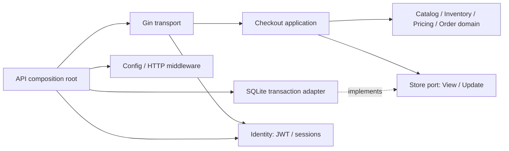

# Go + Gin ecommerce API starter

這是以「業務規則與共用能力分開管理」為主軸的 modular monolith 起手式。四個獨立 `go.mod` 搭配 `go.work` 開發；單一 API process 組裝所有能力，不需要 Kubernetes。

| Go module | 管理的 logic | 可以依賴 |
|---|---|---|
| `modules/commerce` | 電商特有：商品上下架、庫存扣減、優惠、運費、訂單價格快照、結帳、冪等交易、訂單事件、SQLite persistence | domain / application 使用標準函式庫；SQLite driver 僅限 adapter |
| `modules/platform` | 非電商特有：環境設定、request ID、結構化 access log、HTTP body 上限、panic recovery、錯誤 envelope | 標準函式庫 |
| `modules/identity` | 非電商特有：帳號、密碼驗證、JWT、refresh rotation、session 撤銷 | identity domain / ports；crypto 與 SQLite 僅 adapters 引用 |
| `apps/api` | Gin transport、身份入口、HTTP 狀態轉換、啟動／關閉、dependency injection | Gin、commerce、identity、platform |

`commerce` 與 `identity` 不互相依賴，也不 import Gin 或 platform；`platform` 完全不知道商品、訂單或帳號 schema。分類依據是規則的語意，並非名字裡是否有 `service` 或 `helper`。

## 快速執行

需求：Go（Makefile 會選擇 Go 1.26.9 工具鏈）、GNU Make、Bash、`rg`；env helper / smoke 另需 Python 3。依賴需要網路下載。Docker 只用於容器及 CD，日常開發不需要。

```bash
make init-env     # 建立 .env 並生成 JWT signing secret
make run
```

另一個 terminal：

```bash
AUTH_EMAIL=you@example.test AUTH_PASSWORD=choose-a-long-password-123 make smoke
```

`make run` 會讀取本機 `.env`；編譯出的 `bin/api` 只讀 process environment。`.env` 是本機可信任的 shell env 檔，不要放入 Git。

```bash
make check       # 格式、module 邊界、go vet、race tests、build
make tidy        # 每個 module 各自 tidy，GOWORK=off
make build       # bin/api + bin/db
make migrate     # 建立 / 更新 SQLite schema
make seed        # 建立 schema 並匯入商品；可安全重跑
make fmt
```

### 第一筆訂單

先依 [JWT 登入說明](docs/authentication.md) 註冊／登入取得 access token，再使用下列 API。

```bash
curl -sS http://127.0.0.1:8080/v1/products

curl -i http://127.0.0.1:8080/v1/checkouts \
  -H 'Content-Type: application/json' \
  -H 'Authorization: Bearer <登入取得的 access_token>' \
  -H 'Idempotency-Key: checkout-example-001' \
  -d '{"items":[{"product_id":"keyboard","quantity":1},{"product_id":"mouse","quantity":1}],"coupon":"WELCOME10"}'
```

subtotal = 10000、discount = 1000、shipping = 500、total = 9500（USD cents）。運費以折扣後金額判斷：滿 USD 100 免運，否則 USD 5。`WELCOME10` 的預設折扣是 10%，比例由 SQLite `discount_rules.rate_bps=1000` 提供，整數無條件捨去，未限制首次購買。另有固定金額與滿額／上限策略；詳見 [Discount strategies](docs/discount-strategies.md)。

以相同 key 重送相同購物內容，取得原訂單、HTTP 200 及 `replayed: true`；新建訂單為 HTTP 201。相同 key 改動內容得到 HTTP 409。商品排列、重複品項合併、coupon 大小寫及前後空白會先正規化。key 以已驗證的 customer scope 隔離，長度 8–128，不允許空白。

### HTTP endpoints

| Method | Path | 權限／用途 |
|---|---|---|
| GET | `/healthz` | process 存活 |
| GET | `/readyz` | SQLite connection readiness；失敗回 503 |
| GET | `/v1/products` | 公開、僅 active 商品 |
| POST | `/v1/quotes` | Bearer；計算價格，不扣庫存、不保留價格 |
| POST | `/v1/checkouts` | Bearer + `Idempotency-Key`；結帳交易 |
| GET | `/v1/orders/:id` | Bearer；只讀該 subject 的訂單 |

Quote / checkout 共用 payload：

```json
{"items":[{"product_id":"keyboard","quantity":1}],"coupon":"WELCOME10"}
```

註冊／登入／刷新／登出及 `/v1/auth/me` 詳見 [身份驗證 API](docs/authentication.md)。

最多 50 個輸入品項、每個商品合併後最多 100 件；不接受 client 提供價格或 customer ID。未知 JSON 欄位及多個 JSON values 得到 400，非 JSON content type 得到 415，超過 1 MiB 得到 413；業務驗證 422、缺商品 404、缺庫存或 key 衝突 409。錯誤包含 `code`、`message`、`request_id`；回應 header 有 `X-Request-ID`。

## 目錄與編排

```text
apps/api/
  cmd/api/main.go                  # composition root：選擇並注入 adapters
  internal/httpapi/                # Gin routes、auth、DTO、error mapping
modules/commerce/
  domain/catalog/                 # 商品資料／啟用狀態
  domain/inventory/               # 庫存不可負數的純規則
  domain/discount/                # percentage / fixed amount strategies
  domain/pricing/                 # 折扣與運費組合、overflow 防護
  domain/order/                   # immutable price snapshots 與事件
  domain/fault/                   # 業務錯誤，沒有 HTTP status
  application/catalog/           # 商品查詢 use case
  application/checkout/          # quote、下單、訂單 ownership 編排
  ports/                          # repository / unit of work contracts
  adapters/sqlite/               # 預設持久化、migration、商品 seed
  adapters/memory/               # copy-on-write adapter，供快速測試
modules/identity/
  domain/                         # User / Session / identity errors
  ports/                          # Password / AccessTokens / Store interfaces
  application/                    # Register / Login / Refresh / Logout
  adapters/secure/                # Argon2id + JWT
  adapters/sqlite/                # accounts / sessions / refresh hashes
modules/platform/
  config/                         # 共用 env 設定及驗證
  httpx/                          # 標準 net/http middleware
docs/                             # 架構、交易邊界、部署與擴充說明
scripts/                          # architecture checks、smoke、單機 deploy
.github/workflows/ci-cd.yml        # verify → publish → 手動 demo deploy
```



深入閱讀：[架構與業務／非業務分類](docs/architecture.md)、[CI/CD 與單機部署](docs/delivery.md)。

## 這個 starter 的運作範圍

預設使用 SQLite，路徑為 `./data/ecommerce.db`，可由 `DB_PATH` 改寫。API 啟動會自動執行 embedded migrations 與商品 seed；也可先執行 `make seed`，不需要 JWT_SECRET 或啟動 HTTP。Seed 商品為 keyboard（7500 USD cents、庫存 10）與 mouse（2500 USD cents、庫存 20）。重跑只補缺少的 rows，不覆蓋修改過的商品或重設庫存。資料檔及 WAL / SHM 不進 Git；SQL schema / seed 與 module lockfiles 才是可版本管理的來源。

商品、庫存、discount rules、訂單、checkout receipts 與 outbox 都存入 SQLite，重啟後保留。交易使用 WAL、foreign keys、busy timeout 與 BEGIN IMMEDIATE；每個 Store 的 pool 暫限一條連線，寫入依 SQLite writer lock 序列化，適合單機起手式。Memory adapter 保留作測試用途。SQLite 與 seed 的細節：[SQLite 說明](docs/sqlite.md)。

尚無事件發送 worker；訂單停在 `pending_payment`，庫存不會自動到期釋放。身份驗證使用 JWT + rotating refresh token，帳號／session 保存於同一 SQLite；每次受保護請求檢查 session，登出可立即撤銷。詳見 [身份驗證設計](docs/authentication.md)。接真實商務時，再補 payment、reservation expiry、tax、coupon eligibility 及 outbox worker；`APP_ENV=production` 仍拒絕自動 demo seed 的組裝。

版本基準：[Go 1.26.9](https://go.dev/dl/)；[Gin v1.12.0](https://github.com/gin-gonic/gin/releases/tag/v1.12.0)，transitive dependencies 鎖在 `apps/api/go.sum`、`modules/commerce/go.sum` 與 `modules/identity/go.sum`。Module path 使用 `example.com/ecommerce/*`；正式建 repo 時請一致替換所有 `go.mod`、imports、boundary script 中的 prefix。

這個資料夾目前位於外層 workspace 內。GitHub 只執行 **repository root 的 `.github/workflows`**：若要直接使用內附 CI/CD，請把本資料夾內容作為獨立 repository root 推送；若留在現有 monorepo，依 [delivery 說明](docs/delivery.md) 把 workflow 接到根目錄。
