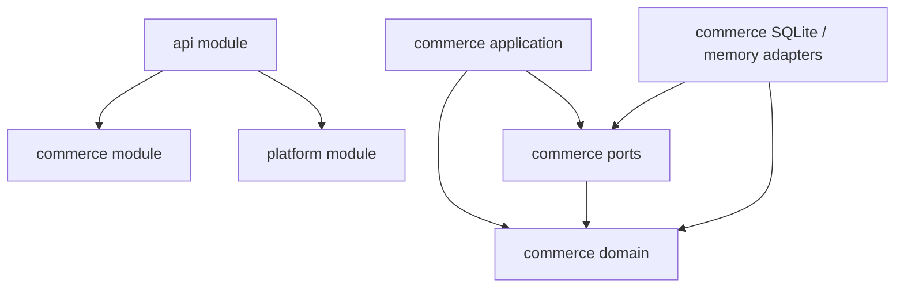
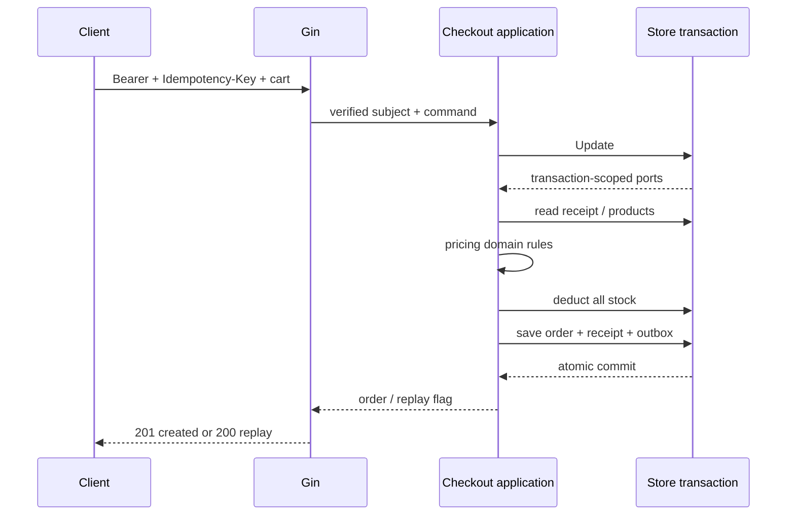

# 分層、模組與 logic 歸屬

## 分類規則

| 需求／logic | 放置位置 | 原因 |
|---|---|---|
| 百分比／固定折扣的演算法 | `commerce/domain/discount` | Strategy 定義電商優惠計算規則 |
| 優惠比例、金額、門檻、cap、active | SQLite `discount_rules` | 設定數值可更改，不需要重新編譯 |
| 折扣與運費順序、最小貨幣單位 | `commerce/domain/pricing` | 組合各種價格規則 |
| 商品 active、庫存足不足、訂單明細與價格快照 | `commerce/domain/*` | 都是交易領域概念 |
| 同一 customer 下的結帳冪等、交易內扣庫存與建訂單 | `commerce/application/checkout` | 是 use case 的協作規則 |
| Store、交易 callback、跨品項原子寫入契約 | `commerce/ports` | 契約包含訂單與庫存語意，屬業務 port |
| Memory / SQLite / PostgreSQL 訂單 repository | `commerce/adapters/*` | 仍知道 order schema；不能因使用 SQL 就放進 platform |
| 通用 DB pool、retry transport、clock、telemetry | 未來的 `platform/*` | 不知道商品、訂單、coupon，才能共用 |
| Request ID、access log、body limit、env parser | `platform/*` | 可以原封不動用於非電商服務 |
| Gin binding、路由、Bearer 驗證、HTTP status | `apps/api/internal/httpapi` | transport / identity adapter 的責任 |
| 選用 repository、注入 clock 與 ID、啟停 server | `apps/api/cmd/api` | composition root 承擔 concrete wiring |

不建立包山包海的 `utils`、`common`、`base service`。冪等是 generic technique，但結帳的 payload 正規化、customer scope、receipt 與交易原子性是商務規則，故本例放在 checkout。新 API 的冪等規則不一定相同。

## 三個 modules，不是三個 services

`go.work` 提供跨 module 本機編輯；`apps/api/go.mod` 的相對 `replace` 保證 `GOWORK=off` 也能獨立 build / test。CI 刻意逐一測試每個 module，避免 workspace 掩蓋遺漏依賴。platform 沒有 third-party dependencies；commerce 的 SQLite driver 及 transitive dependencies 鎖在自己的 `go.sum`，僅 adapter 引用。

目前按穩定性區分 module：platform、commerce、api。catalog / inventory / pricing / order 是 commerce 裡的 capability packages，沒有各自增加 `go.mod`。當某個能力有獨立版本、團隊或部署需求，再抽成 module。單純增加 `go.mod` 不等於可獨立部署，也不能消除跨服務交易問題。

依賴方向：

`scripts/check-boundaries.sh` 會檢查 transitive imports：commerce / platform 不依賴彼此或 api，不引用 Gin；domain 不引用 application / ports / adapters；application 不引用 concrete adapters。HTTP 的 tests 可以組裝 memory adapter，application tests 也可使用 adapter 測交易契約。

## 結帳的交易邊界

1. 驗證 customer、key、購物內容；合併重複品項、排序、正規化 coupon，產生 fingerprint。
2. `Store.Update` 開始 transaction；以 `(customer, key)` 讀取 receipt。有相同 fingerprint 就返回原訂單，不同 fingerprint 回報 conflict。
3. 從 transaction 中讀取商品價格，拒絕 inactive / 非 USD 商品；讀取同 transaction 的 discount rule，domain discount Engine 分派 Strategy，再由 pricing 組合優惠與運費。
4. domain inventory 檢查數量；adapter 原子扣庫存。
5. 建立 `pending_payment` 訂單，保存商品名稱、單價、discount rule 與 totals 的 snapshot，之後商品改價不影響原訂單。
6. 保存 order、receipt 與 `order.placed.v1` outbox event。
7. 成功才 commit；錯誤或 commit 前 context cancellation 都回滾整筆交易。

預設 SQLite adapter 使用 BEGIN IMMEDIATE 與條件式庫存 UPDATE，order / receipt / outbox 寫入使用同一個 SQL transaction。所有 SQL 讀寫錯誤都透過 ports 的 error 回傳，不會把 DB 失敗誤判成空商品或不存在的 receipt。SQLite transaction tests 覆蓋重啟、seed 重跑、兩個 Store 的併發防超賣與冪等，以及 outbox 失敗後完整回滾。Memory adapter 保留全域鎖與 copy-on-write 作快速測試。不要在 callback 裡呼叫 payment gateway、HTTP、寄信，或再次進入同一 Store，會拖住所有交易，巢狀呼叫也可能 deadlock。

## 接 PostgreSQL 時

新增 `commerce/adapters/postgres` 實作同一個 `ports.Store`，只在 composition root 改 wiring。建議 tables：products、inventory、orders、order_lines、checkout_receipts、outbox。

- 單一 SQL transaction 同時寫庫存、訂單、receipt、outbox；callback 必須使用 transaction connection。
- 庫存採條件更新 `UPDATE inventory SET available = available - $qty WHERE product_id = $id AND available >= $qty` 並確認 affected row count。商品 ID 的操作順序固定，降低多品項 deadlock。
- `(customer_id, idempotency_key)` UNIQUE；需在扣庫存前取得 key 的 transaction ownership，例如 transaction-level advisory lock，再重查 receipt。不能只做「查不到就 INSERT」，併發會競爭。
- product pricing 在同一 snapshot 讀取；需要與改價流程協調時加 row lock。不同隔離層級的 retry 必須重做完整交易。
- DB commit error 可能結果未知。client 重送相同 key，透過已保存的 receipt 判定，不可直接再扣庫存。
- outbox worker 以 claim / retry / published_at 發送事件；事件 ID 對應 consumer 去重。目標是 at-least-once delivery，不能宣稱 exactly-once。
- order lines / stock / receipt / outbox 要補 migration 與真實 DB 的 integration tests。memory 測試不能證明 SQL adapter 的隔離層級正確。

## 新增更多電商 logic

`application/checkout` 是多能力協作的入口。加入 payment 時，新增 `domain/payment` 的狀態規則、`ports` 的 payment gateway interface 與 `adapters/payment`，交易之外執行 authorize / capture，並用 webhook use case 驗證簽名、金額與去重，再進 transaction 轉狀態。不要把信用卡或 raw webhook body 混入 access log。

加入訂單取消／到期時，建立 `application/orders` 編排：驗證 pending state、轉 cancelled / expired、釋放 reservation、寫 outbox，四件事同一 transaction。worker 可重試，但釋放庫存必須僅一次。這些 use cases 尚未實作，現在的 pending order 不會自動釋放庫存。

Discount rounding、滿額運費、tax、會員資格、promotion eligibility 都放在明確命名的 domain policy；跨 policy 的順序由 application 決定。跨服務後才使用 saga / compensation；目前同一 DB / process 用 local transaction 即可。

Identity adapter 應把已驗證 JWT / session 轉成 subject，customer ID 不能來自 request body。demo Bearer middleware 已示範這個邊界，但僅對應一個固定 customer。Quote 是試算，不承諾庫存或鎖價；checkout 永遠重新讀 server-side price。
