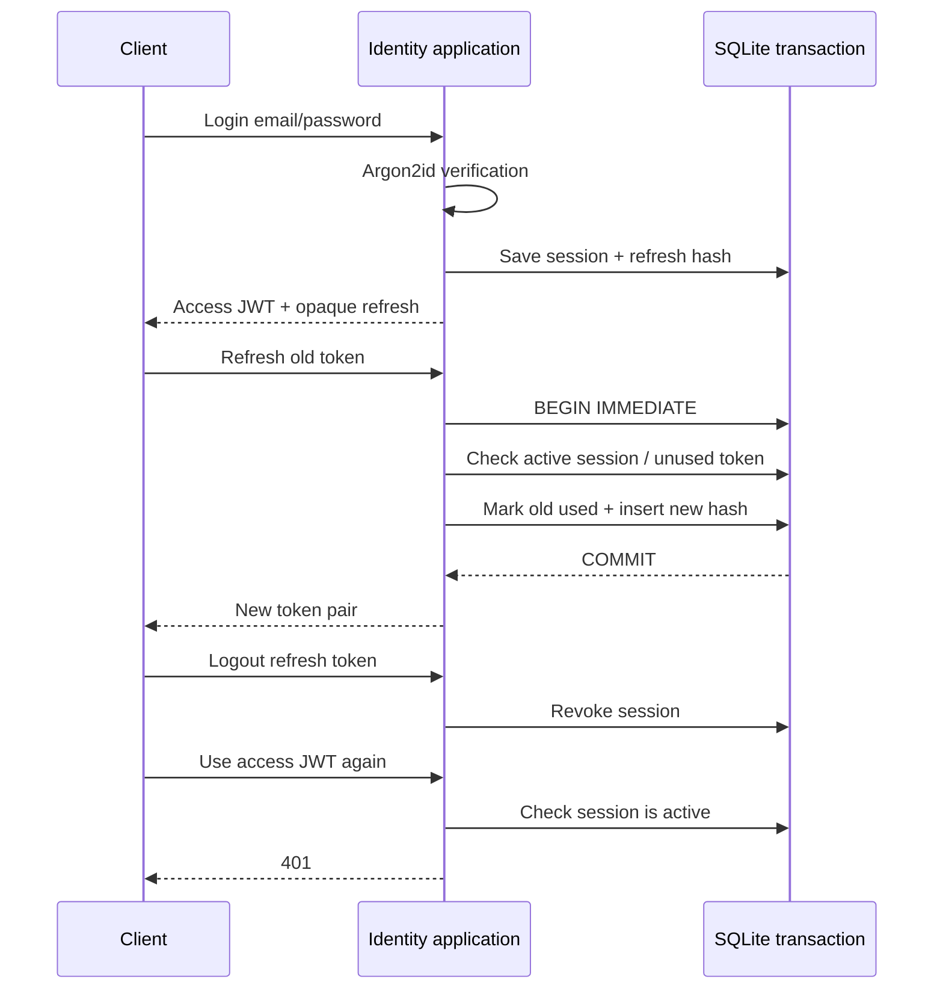

# JWT + rotating refresh token

Authentication lives in the independent `modules/identity` Go module. Domain/application code has no Gin, commerce, or platform dependency. API transport uses a verified user's ID as the checkout customer ID. Password/JWT adapters are under `identity/adapters/secure`; account/session persistence is under `identity/adapters/sqlite`.

## Local setup

```bash
make init-env
make run
```

`make init-env` creates `.env` from the example if missing, generates a random 32-byte JWT signing secret if absent/blank, preserves existing settings and secrets, and sets file permissions to 0600. It never prints the key. The secret is standard base64 in `JWT_SECRET`, is ignored by Git/Docker context, and must stay the same across restarts to keep existing JWTs valid. `API_TOKEN` / `API_SUBJECT` are no longer authentication inputs.

Defaults: HS256 access JWT **15 minutes**; refresh/session lifetime **30 days**, absolute, not extended by rotation. `ACCESS_TOKEN_TTL` supports 1m–1h; `REFRESH_TOKEN_TTL` supports 1h–2160h and must exceed the access lifetime. Issuer/audience default to `ecommerce-api` / `ecommerce-clients` and are verified alongside signature, algorithm, token type, expiry, issued-at and not-before.

No default user or password is seeded. Create an account:

```bash
curl -i http://127.0.0.1:8080/v1/auth/register \
  -H 'Content-Type: application/json' \
  -d '{"email":"you@example.test","password":"choose-a-long-password-123"}'

curl -sS http://127.0.0.1:8080/v1/auth/login \
  -H 'Content-Type: application/json' \
  -d '{"email":"you@example.test","password":"choose-a-long-password-123"}'
```

Email is trimmed and lowercased, and the bare address must be valid. Passwords are not trimmed, require at least 12 Unicode characters, and have a 1024-byte maximum. Registration returns user ID/email only; login returns:

```json
{
  "access_token": "<signed JWT>",
  "refresh_token": "<random opaque token>",
  "token_type": "Bearer",
  "expires_in": 900,
  "refresh_expires_at": "<absolute session expiry>"
}
```

| Method | Path | Input / behavior |
|---|---|---|
| POST | `/v1/auth/register` | email/password; 201, duplicate email 409 |
| POST | `/v1/auth/login` | email/password; 200 token pair; invalid credentials 401 |
| POST | `/v1/auth/refresh` | `{"refresh_token":"..."}`; consumes old token and returns a new pair |
| POST | `/v1/auth/logout` | `{"refresh_token":"..."}`; revokes that session; idempotent 204 for well-formed tokens |
| GET | `/v1/auth/me` | access JWT in `Authorization: Bearer ...`; user ID/email |

Quotes, checkout and order reads use the access JWT in the same Bearer header. Never send tokens in URL query parameters. Logout accepts the refresh token, so it remains usable after the access JWT expires. After logout, the client should discard both tokens.

## Rotation, replay detection and immediate logout



Each login creates a distinct session (token family), so logging out one device does not revoke another login. The JWT carries `sub`, `sid`, `jti`, `iss`, `aud`, `exp`, `iat` and `nbf`. Every protected request verifies the JWT **and** checks SQLite session/user status; this extra DB lookup makes logout and refresh-reuse revocation effective for future requests immediately. Already executing requests are not cancelled.

Refresh tokens contain 256 bits of cryptographic randomness. SQLite stores only SHA-256 hashes, never raw refresh tokens. Used hashes are retained to detect replay. Reusing an old token revokes the whole session, including the most recently rotated refresh token and all access JWTs for that session. Crucially, the revocation transaction commits before returning 401. This follows the refresh rotation/replay model in [RFC 9700](https://www.rfc-editor.org/rfc/rfc9700.html#section-4.14).

Clients must serialize refresh operations per session. Concurrent refreshes or retrying a consumed token after a lost response trigger revocation and require login again; there is no grace window. Successful rotation does not invalidate an earlier access JWT before its expiry, provided its session stays active.

Passwords use Argon2id, a unique 16-byte salt and versioned parameters: 19 MiB memory, 2 passes, 1 lane. Two concurrent hash operations are allowed. Unknown emails verify against a dummy hash before returning the same 401 as a wrong password. Parameters follow [OWASP password storage guidance](https://cheatsheetseries.owasp.org/cheatsheets/Password_Storage_Cheat_Sheet.html).

SQLite tables: `auth_users`, `auth_sessions`, `auth_refresh_tokens`, with independent `identity_schema_migrations`. Commerce tables and old orders are preserved. Historical orders owned by the previous fixed `demo-customer` identity are not silently assigned to a new account. Disabled users are rejected by login, refresh and access validation.

## Transport and operation

This is an API/client flow returning both tokens in JSON, without authentication cookies. Mobile clients should use platform secure credential storage; browser integration should add a refresh HttpOnly cookie/BFF adapter with appropriate CSRF controls rather than keeping durable refresh credentials in localStorage. HTTPS is required outside local development. Cookie transport, email verification, password reset, MFA and roles are outside this implementation.

Auth responses are `Cache-Control: no-store`; logs omit passwords, bodies, auth headers and tokens. Credential/refresh endpoints have a bounded process-local limit of 30 requests/IP/minute; Gin trusts no proxy by default, so spoofed X-Forwarded-For cannot bypass it. Configure trusted proxies narrowly if adding a reverse proxy, and use shared limiting when adding replicas. Registration's 409 intentionally identifies already registered email addresses.

Expired token-family cleanup is not automatic. Retain used hashes until the family expires; a maintenance job can delete tokens belonging to expired sessions, then the sessions. Never delete recently consumed tokens from active sessions, which would remove replay evidence.

Changing JWT_SECRET invalidates existing access JWTs; persisted refresh tokens can still rotate to an access token signed with the new key. Losing/restoring the identity database changes session state, so backup/restore policy must include these tables. `APP_ENV=production` remains blocked by this starter's automatic demo product/discount seed policy.

```bash
make check
make smoke-persistence
AUTH_EMAIL=you@example.test AUTH_PASSWORD=choose-a-long-password-123 make smoke
```

Tests cover Argon2 salts and wrong passwords, invalid JWT signature/algorithm/type/issuer/audience/expiry, registration validation, token rotation and reuse, concurrent refresh across connections, rollback on rotation failure, disabled users, session expiry, device isolation, logout, order ownership, rate limiting and API restart persistence. GitHub CI includes the identity module and authenticated smoke.
