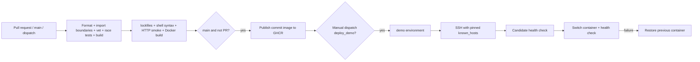

# CI/CD 與單機部署

## Repository 放置方式

內附 workflow 以這個 starter 為 repository root。現在的外層 workspace 不會自動執行巢狀 `.github/workflows`。獨立 repo：把 starter 內容推到新 repository 的 root，default branch 使用 `main`（其他名稱請修改 workflow 的 branch filter / publish condition）。本起手式不會替你 init、commit 或 push 到遠端。

若保留於外層 monorepo：將 workflow 複製至外層 `.github/workflows/`，設定 `defaults.run.working-directory: Golang-with-Gin-ecommerce-API-starter-202610`，並把 setup-go 的 `go-version-file` / `cache-dependency-path` 加上該 prefix；checkout action 仍在 root。調整 SSH stdin 的 script path 時，注意它是相對 run working-directory。Dependabot 的 directory 也需加上 prefix。

## Pipeline



CI 不讀部署 secrets。只有 main 的成功 workflow 會用 `GITHUB_TOKEN` 發佈 GHCR，image tag 為 commit SHA，部署使用 `RepoDigest` 的不可變 `sha256` reference。沒有 latest-tag 覆蓋後內容不明的問題。

CI 也用 stateful Docker stub 測 deploy 成功、候選健康失敗、新版啟動失敗、新版健康失敗與 rename 失敗後回滾。可本機執行 `make test-deploy`；Bash、`flock` 為需求，macOS 可在 Linux container 裡執行。

Demo deploy 只在 main 的 **workflow_dispatch + deploy_demo=true** 執行，且依賴 verify / publish 成功。可選擇在 GitHub `demo` environment 設 reviewer；repo owner 決定是否啟用。即使沒有 host，CI 與 image publish 仍可運作。

## GitHub 設定

1. 建立 environment `demo`。
2. Environment variables：`DEPLOY_HOST`（hostname / IPv4）、`DEPLOY_USER`（SSH user）。目前 SSH port 固定 22，不接受 IPv6 literal。
3. Environment secrets：`DEPLOY_SSH_KEY`、`DEPLOY_KNOWN_HOSTS`。KNOWN_HOSTS 需經管理者從可信任管道核對 host fingerprint；workflow 不會無條件信任 `ssh-keyscan`。
4. 確保 GHCR package write 允許 workflow 的 GITHUB_TOKEN。
5. 若 GHCR package 是 private，在 remote host 預先用最小 `read:packages` credential 執行 `docker login ghcr.io`；workflow 不會把 GitHub publish token 傳到 host。

## Demo host 設定

Linux host 需求：Docker Engine、Bash、`flock`。SSH user 必須可操作 Docker、讀取 env 檔、寫入 deploy lock。Docker group 相當於 host 管理權限，請使用專用部署帳號。

由 host 管理者準備：

```bash
sudo mkdir -p /opt/ecommerce
sudo chown <deploy-user>:<deploy-user> /opt/ecommerce
install -m 600 /dev/null /opt/ecommerce/demo.env
```

`/opt/ecommerce/demo.env`：

```dotenv
API_TOKEN=replace-with-a-long-random-demo-token
API_SUBJECT=demo-customer
```

env 留在 host，不進 Git、不經 Actions log。部署 script 強制 APP_ENV=demo / HTTP_ADDR=:8080，只在 host `127.0.0.1:8080` 提供服務，可經 SSH tunnel 或另外設定 TLS reverse proxy 連入。

Script 先 pull image，在 `127.0.0.1:18080` 啟動候選 container，通過 image healthcheck 再停止舊版、啟動新版。若新版啟動或健康檢查失敗，會恢復前一個 container；舊版會留在 `ecommerce-api-previous` 直到下一次部署。切換有短暫停機，不是 zero-downtime deployment。

正式 demo container 的 `/data` 掛載 `ecommerce-api-data` named volume，SQLite 與 WAL / SHM 隨 container 重建仍保留。候選 container 使用獨立 tmpfs，健康檢查不碰 live DB。部署 rollback 恢復程式版本並使用同一資料，不會回滾 schema 或資料；新增 migration 應維持前後版本相容，破壞性修改需要先規劃 DB backup / restore。此版本仍是 demo identity，自動 seed 只插入缺少 rows，不重設已售庫存。

Script 使用非 root container、read-only filesystem、drop capabilities、no-new-privileges、資源及 log 上限；不建立 Kubernetes 資源。候選執行中的 healthcheck 不建立訂單，不消耗庫存。

## 本機 Docker

```bash
docker build -t ecommerce-api:local .
docker run --rm -p 127.0.0.1:8080:8080 \
  -e API_TOKEN=local-development-token-change-me \
  --mount type=volume,source=ecommerce-api-data,target=/data \
  ecommerce-api:local
```

API_TOKEN 必須至少 16 字元；APP_ENV 預設 demo，DB_PATH 預設 `/data/ecommerce.db`。未掛 volume 時，移除 container 會移除其資料。若用 `.env` 配 `--env-file`，記得 override `HTTP_ADDR=:8080`，否則範例中的 `127.0.0.1` 會只綁 container loopback。

## 驗證範圍

`make check` 執行 race detector，涵蓋併發防超賣、同 key 併發重送、冪等衝突、ownership、交易失敗與取消回滾、價格及整數 overflow、HTTP auth / JSON / body size / replay、panic recovery。另外測試真實 SQLite transaction、重啟後保存、seed 不重設庫存／商品、DB foreign keys、SQL 失敗傳遞及跨 Store 併發；CI 另做真正 HTTP server smoke 與 Docker build。

實際 GitHub pipeline / GHCR push / SSH deployment 需 repository 與 host 設定後才能驗證。起手式只提供設定及執行腳本，不在開發機上執行遠端部署。
